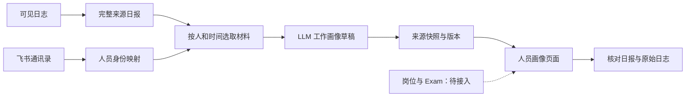
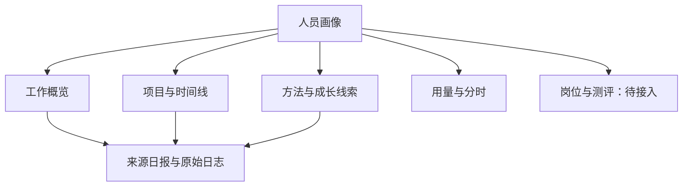

# 人员画像：维度、数据流与实现设计

日期：2026-11-04。范围：独立 We-Manage。本文是设计交付；标注“后续”的能力尚未上线。

## 目标

让管理者理解一个人正在承担什么工作、解决什么问题、形成什么方法，以及有哪些能跨时间比较的成长线索。每项判断应能回到来源，不依据 Token、调用量或在线时间推断绩效。

## 维度与数据

| 维度 | 展示内容 | 来源与状态 | 判断边界 |
|---|---|---|---|
| 组织身份 | 姓名、部门、在职状态 | 飞书通讯录镜像，已接入 | 历史工作按当前部门归属，不代表历史任职 |
| 岗位与职责 | 岗位、职责范围、任职日期 | 后续接入经确认的飞书表格或岗位资料 | 不从聊天内容猜测正式岗位 |
| 工作内容 | 目标、关键动作、具体产出 | 日报与日志，已有画像生成 | 模型建议与实际执行分开 |
| 项目参与 | 参与项目、阶段、承担事项 | 项目线索已有；结构化职责归属后续建设 | 请求归属不能自动证明项目负责人身份 |
| 方法与经验 | 方法、场景、结果、限制 | 日报与知识候选，已有 | 与原始证据不符时保留待核对状态 |
| 成长线索 | 同类问题在不同时点的处理变化 | 画像可从跨日日报归纳 | 无可比样本则显示证据不足；不做性格或能力评分 |
| Exam | 测评名称、版本、日期、成绩、评分规则 | 后续接入；需要明确来源系统和员工映射 | 不同版本分数不直接比较；与日志推断分开 |
| 工作偏好 | 常用方法、工具及表达习惯 | 后续做可纠正的描述 | 不把行为偏好作为稳定人格判断 |
| 资源投入 | Token、模型、参考费用、分时调用 | 已接入 | 不是工时或贡献度 |

## 数据流图

所有读取和生成入口先校验权限；私密人员以及含隐藏项目的人员日报排除。来源后来变私密时，已有分析也不再展示。

## 结构图

## 页面实现形式

顶部仅保留姓名、部门、日期选择；第一屏展示工作概览、项目和待核对问题。方法与成长放在第二层，用量独立分组。每条线索可展开依据。未接入的岗位、Exam 不填假值，也不画零分雷达图。必要说明集中放入“数据范围”，避免每块重复。

当前模型结果为文字草稿。下一步可将事实项拆为稳定编号，增加人工纠正和历史版本：内容、来源编号、来源日期、判断状态、核对人、核对时间。事实纠正不覆盖原始日志。

## 实施顺序与验收

1. 先用现有日报形成一人的跨日工作画像，逐项核对来源，确认无其他人员私密内容混入。
2. 接入岗位表时使用稳定员工 ID；无法映射的行保留待处理，不按姓名直接覆盖。
3. Exam 数据单独建表，记录试卷及评分版本；只有同口径结果允许趋势比较。
4. 最后增加人工修正与共享范围；当前入口仍限有效超级管理员，不能将此文档视为已上线全员共享。

通过标准：核心事实均有来源；未完成与建议不混写成成果；日期范围可解释；缺失数据不推断为未工作；私密人员在读取、生成和历史展示三个环节均排除。业务验收由负责人填写。
